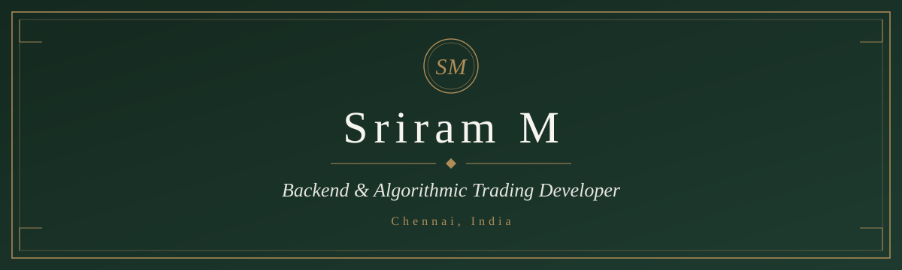
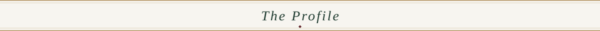
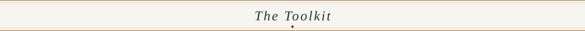
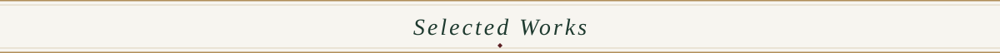
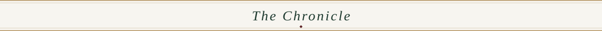
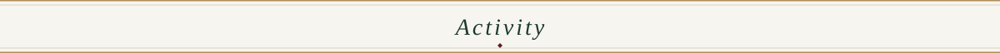
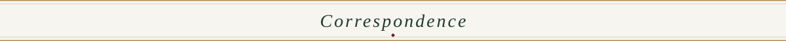
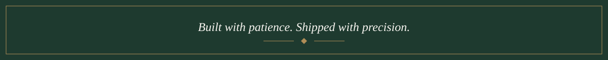

 

 

 

*Real-time trading systems, scalable backends and AI products.*

 

I am a backend and algorithmic trading developer based in Chennai. My work centres on Python services, broker API integrations and the infrastructure that keeps live market systems dependable, from order execution on NIFTY and SENSEX derivatives to the dashboards that make those systems legible.

I also build full-stack applications and applied AI products, and I care as much about clean system design and clear documentation as I do about the code itself.

 

 

**Languages & Frameworks**

 

  

**Markets & Integrations**

 

  

**Disciplines**

 

 

 

| Work | Description | Stack |
| :--- | :--- | :--- |
| **Derivatives Trading Systems** | Automated NIFTY and SENSEX derivatives trading systems built on live broker APIs, with attention to execution reliability. | Python, DhanHQ, Flattrade |
| **FinSight** | A financial analysis and DCF valuation platform for listed companies, scoped into a focused first release. | Python, FastAPI, Next.js |
| **CoinSwitch Trading Data Platform** | An API data collector paired with a dashboard for exploring collected trading data. | FastAPI, SQLite, Next.js |
| **NSE Signal Screener** | A stock screener for NSE-listed equities, extending the same trading-platform foundation. | Python |
| **RAG & Voice AI** | Retrieval-augmented and voice-driven AI applications. | Python |
| **B2B ERP** | Business application work covering core ERP workflows. | Full-stack |

Further detail and case studies live on the <a href="https://sriramio.vercel.app/">portfolio</a>.

 

 

<table>
  <tr>
    <td width="22%" valign="top"><b>Dec 2024 – Present</b></td>
    <td valign="top">
      <b>Algorithmic Trading Developer & Full-Stack Engineer</b> 
      UVFarms, Remote 
      Designing and operating NIFTY and SENSEX derivatives trading systems on DhanHQ and Flattrade, alongside RAG, Voice AI and B2B ERP projects.
    </td>
  </tr>
  <tr>
    <td width="22%" valign="top"><b>2021 – 2023</b></td>
    <td valign="top">
      <b>B.Com, Information Systems Management</b> 
      SRM Institute of Science and Technology
    </td>
  </tr>
</table>

 

 

 

 

 

I am open to conversations about backend engineering, trading systems and applied AI.

 

 

